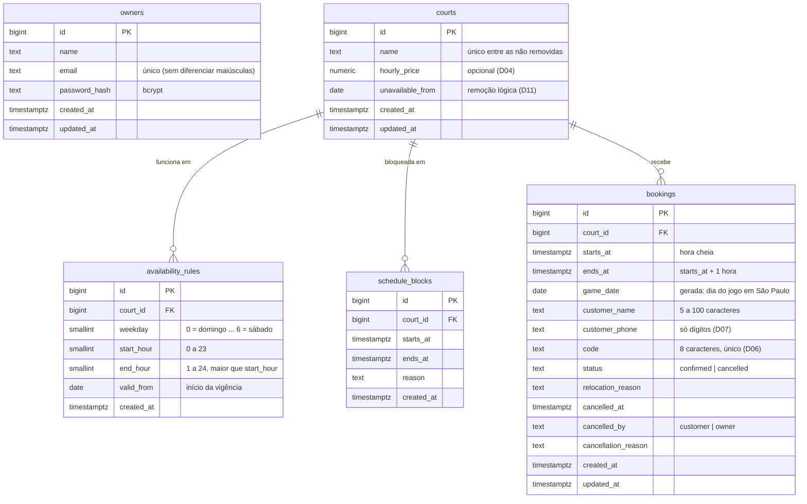

# Modelo de dados

Esquema do PostgreSQL usado pela API (issue #5). As migrations ficam em `api/migrations/` e rodam do zero no Neon e no PostgreSQL local dos testes.

> **Status:** proposta para revisão do grupo (critério de aceitação da #5). Comentem na issue antes do merge.

## Diagrama

`owners` não se liga às outras tabelas: o sistema tem um único proprietário (D09), e todas as quadras são dele.

## Regras garantidas pelo banco

| Regra                                               | Como é garantida                                                                                                                                                    |
| --------------------------------------------------- | ------------------------------------------------------------------------------------------------------------------------------------------------------------------- |
| Uma reserva confirmada por quadra e horário (RNF01) | Índice único parcial `bookings_court_slot_confirmed_key` em `(court_id, starts_at) WHERE status = 'confirmed'`. Reserva cancelada sai do índice e libera o horário. |
| Reserva de exatamente 1 hora (RF02)                 | `CHECK (ends_at = starts_at + interval '1 hour')`                                                                                                                   |
| Início em hora cheia                                | `CHECK (date_trunc('hour', starts_at, 'America/Sao_Paulo') = starts_at)`                                                                                            |
| Dia do jogo no fuso local (D01, RF03)               | Coluna gerada `game_date`, calculada com o fuso `America/Sao_Paulo` fixo, sem depender do fuso da sessão. Reservas às 23h e à 0h caem em dias diferentes.           |
| Telefone só com dígitos (D07)                       | `CHECK (customer_phone ~ '^[1-9][1-9][0-9]{8,9}$')`: DDD sem zero + 8 ou 9 dígitos.                                                                                 |
| Código da reserva (D06)                             | `UNIQUE (code)` e `CHECK (code ~ '^[A-HJ-NP-Z2-9]{8}$')` (sem `0`, `O`, `1`, `I`).                                                                                  |
| Cancelamento consistente                            | Reserva cancelada sempre tem `cancelled_at` e `cancelled_by`; confirmada nunca tem.                                                                                 |
| Quadra com reservas não some                        | `bookings.court_id` usa `ON DELETE RESTRICT`. A remoção é lógica, por `unavailable_from` (D11).                                                                     |
| Faixas de horário sem sobreposição                  | Restrição de exclusão (`btree_gist`) por quadra, dia da semana e vigência.                                                                                          |
| E-mail do proprietário único                        | Índice único em `lower(email)`.                                                                                                                                     |
| Senha nunca em texto puro                           | `CHECK (char_length(password_hash) >= 50)`, e o seed grava só o hash bcrypt.                                                                                        |

O limite de 2 reservas por dia (RF03) **não** é uma restrição do banco: ele depende de contar reservas, o que o PostgreSQL não faz numa `CHECK`. A API faz a contagem e a inserção na mesma transação, com `pg_advisory_xact_lock` por telefone e dia (D16, issue #15). O índice `bookings_phone_game_date_confirmed_idx` deixa essa contagem rápida.

## Fuso horário

- Datas e horas são gravadas como `timestamptz` (instante absoluto).
- A migration define `America/Sao_Paulo` como fuso padrão das conexões do banco.
- Toda regra que depende de "dia" ou "hora cheia" usa o fuso explícito, então funciona mesmo que uma conexão esteja em UTC.

## Disponibilidade das quadras (para a #12)

Uma **vigência** é o conjunto de faixas de uma quadra com o mesmo `valid_from`. Para uma data D, valem as faixas da vigência com o maior `valid_from <= D`. Assim, editar o horário a partir de uma data não altera o passado nem apaga reservas já feitas (que ficam sinalizadas para o proprietário realocar).

Uma faixa `start_hour = 8`, `end_hour = 22` gera os horários de 8h, 9h, ..., 21h. Bloqueios pontuais (manutenção) ficam em `schedule_blocks` e escondem os horários que tocam o período.

## Pontos para o grupo decidir

1. **Histórico de realocação (#19):** a #19 pede histórico com horário anterior, novo horário e motivo. Este modelo guarda só o motivo da última realocação em `bookings.relocation_reason`. A sugestão é que a #19 crie uma tabela `booking_changes` na própria migration dela.
2. **Nome de quadra reutilizável:** quando uma quadra recebe `unavailable_from`, o nome dela fica livre para uma quadra nova. Se preferirem manter o nome bloqueado até a data de remoção passar, a mudança é só no índice.
3. **D01 ainda aberta na #1:** o modelo assume "dia do jogo". Se o grupo ou o professor decidir "dia em que a reserva foi feita", a contagem passa a usar `created_at` e o índice muda.
